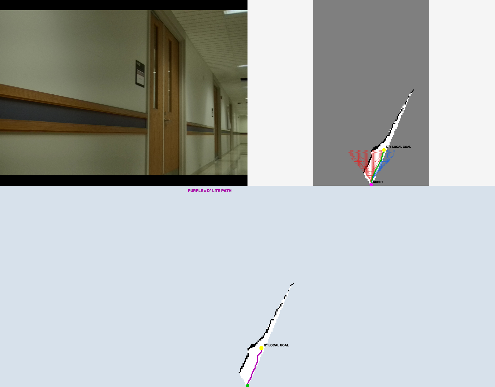

# Occupancy-Aware Local Planner

This is a local-planning project I built for navigating through a 2D occupancy grid.

Instead of directly committing to one path, the planner first generates a set of possible short-range trajectories in front of the robot. It checks each trajectory against the occupancy grid, rejects unsafe options, scores the remaining candidates, and selects a local goal.

The project is designed so that the occupancy grid can come from different perception or mapping systems. For my experiments, I used occupancy grids generated by my separate monocular occupancy-grid project.

## How It Works

The planning pipeline is:

```text
2D Occupancy Grid
       ↓
40 Lookahead Candidates
       ↓
Collision Checking
       ↓
Candidate Scoring
       ↓
Best Lookahead Path
       ↓
Selected Local Goal
       ↓
Downstream Grid Planner
       ↓
Local Path
```

The main part of this repository focuses on the lookahead generation, occupancy checking, scoring, and local-goal selection.

The final grid-path planning stage is treated as a separate downstream component and is not included as source code in this repository.

## Lookahead Candidates

For each occupancy grid, the planner generates 40 smooth candidate paths approximately 3 meters in front of the robot.

The paths cover different possible steering directions so the planner can evaluate several ways of moving through the local environment instead of only trying to move straight ahead.

A straight-ahead direction is used as the current reference direction.

## Occupancy Checking

Each complete candidate path is checked against the occupancy grid.

A candidate is rejected if it:

- collides with occupied space
- leaves the known map boundaries

Unknown space is allowed, but it is penalized during scoring.

The path is checked along the full trajectory rather than only checking its endpoint.

## Candidate Scoring

After unsafe candidates are removed, the remaining paths are scored using several factors:

- obstacle clearance
- alignment with the reference direction
- amount of known space
- forward progress
- path smoothness

Obstacle clearance currently has the strongest influence on the score.

This is useful in places such as corridors because the planner should not simply choose a path that barely avoids a wall. Paths with more surrounding free space are preferred.

For example, when the robot is moving along a corridor and the reference direction points forward, the scoring tends to favor paths through the more open middle region rather than paths that travel unnecessarily close to either wall.

This is not a hard-coded corridor-center rule. It comes from combining obstacle clearance with the other scoring terms, so the planner can still move away from the middle when obstacles or the environment require it.

## Local Goal Selection

The endpoint of the highest-ranked feasible lookahead path becomes the local planning goal.

This separates the problem into two parts:

```text
Lookahead system → decides WHERE to go locally

Grid planner     → decides HOW to reach that goal
```

This also makes the lookahead system independent of one specific downstream path-planning algorithm.

## Occupancy Grid Input

The planner expects a 2D occupancy grid.

The grids used in my experiments use:

```text
-1 = unknown
 0 = free
100 = occupied
```

The planner itself does not generate the occupancy grid.

This means it can be used with occupancy grids produced by different mapping or perception systems.

For my current experiments, I used grids generated by my separate monocular occupancy-grid project.

## Demo

The demo video shows the real camera view next to the occupancy grid and lookahead-planning result:

```text
demo/lookahead_planner_demo.mp4
```

The visualization shows:

- candidate lookahead paths
- rejected and feasible paths
- the selected path
- the selected local goal

A few additional examples also include the resulting downstream grid path.



More examples are included here:

```text
demo/examples/
├── example_56.png
├── example_75.png
└── example_90.png
```

The recorded data used for these demonstrations came from manually driven robot runs.

Because of that, these images are offline planning examples on individual occupancy grids. They should not be interpreted as recordings of the physical robot following the generated paths.

## Running the Planner

Install the required Python packages:

```bash
pip install -r requirements.txt
```

Then provide an occupancy-grid NumPy file:

```bash
python3 src/local_planner.py \
  --og /path/to/occupancy_grid.npy \
  --output output/
```

The planner will evaluate the lookahead candidates and save the resulting visualization and selection information.

## Project Structure

```text
occupancy-aware-local-planner/
├── src/
│   └── local_planner.py
│
├── demo/
│   ├── lookahead_planner_demo.mp4
│   └── examples/
│       ├── example_56.png
│       ├── example_75.png
│       └── example_90.png
│
├── README.md
├── requirements.txt
├── .gitignore
└── LICENSE
```

## What Is Not Included

This repository intentionally does not include:

- occupancy-grid generation code
- ROS bag recordings
- pretrained model weights
- generated NumPy datasets
- external downstream path-planner source code

The goal is to keep this repository focused on the local lookahead and goal-selection system.

## Next Steps

I want to continue developing the planner toward real-time robot navigation.

Some areas I want to explore are:

- continuously updating the local goal as the robot moves
- checking whether the active path becomes blocked
- triggering replanning when the environment changes
- using odometry to track paths between occupancy-grid updates
- adapting the lookahead horizon based on the environment
- improving scoring for narrow corridors and cluttered spaces
- integrating higher-level navigation commands

## Note

This is an experimental local-planning project.

The current results are evaluated offline on recorded occupancy grids and should not be treated as a safety-critical navigation system.
